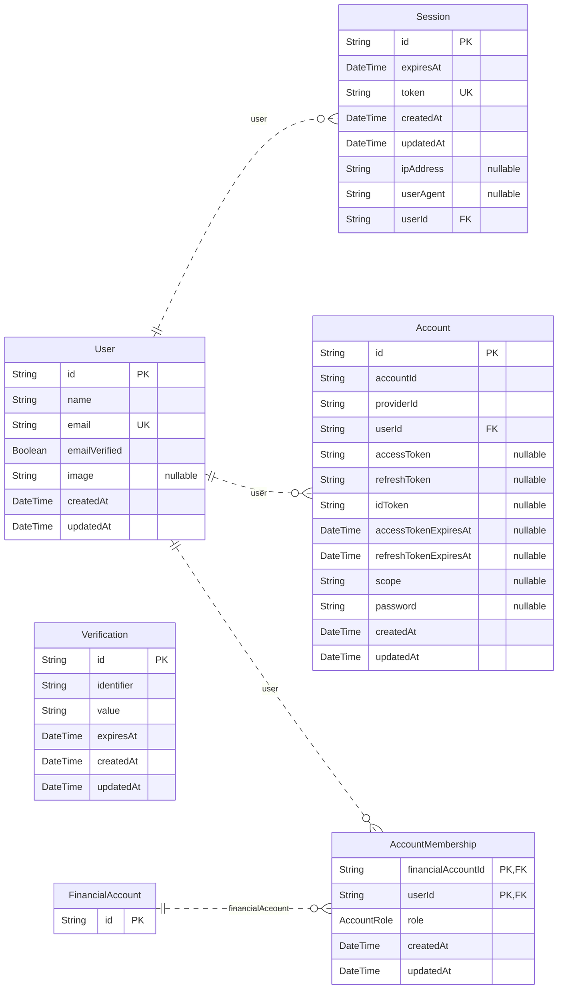
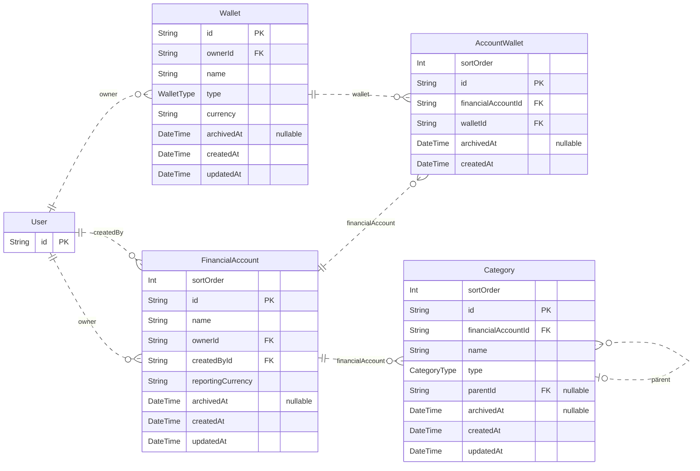
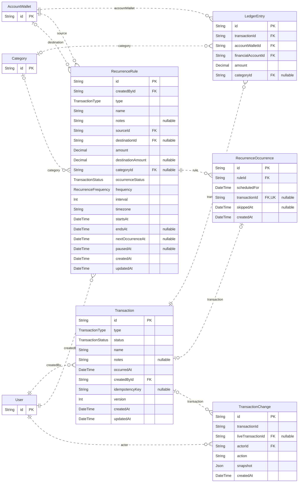
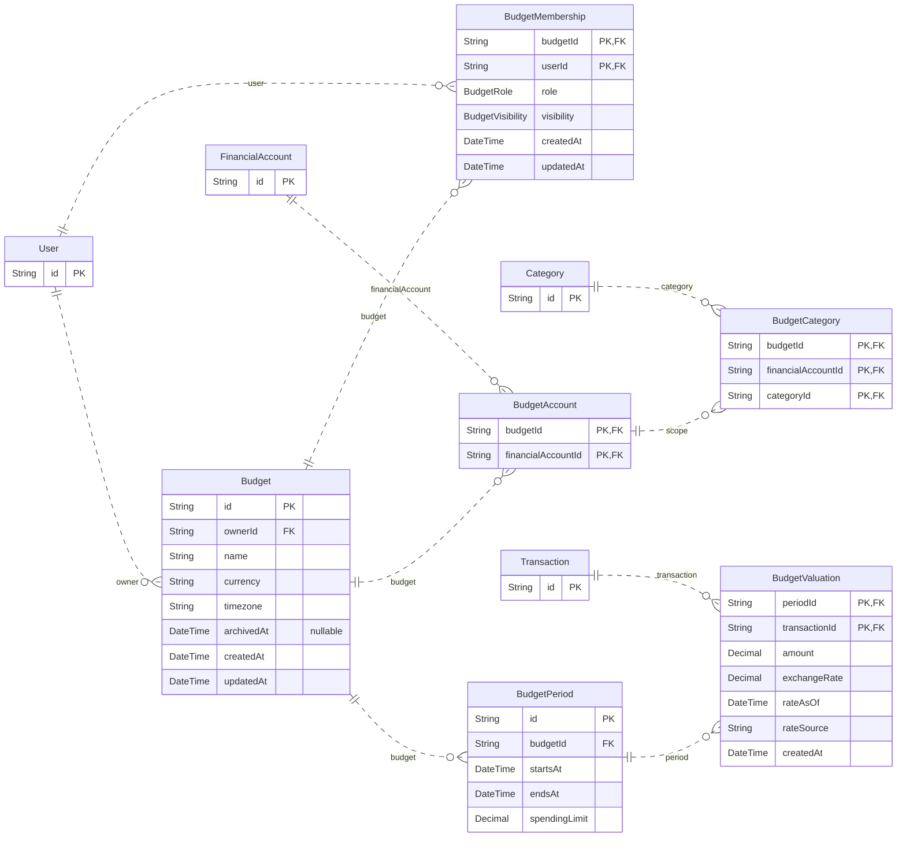

# Fintrack entity relationship diagrams

<!-- Generated by scripts/generate-erd.mjs. Edit the Prisma schema or generator, then run pnpm db:erd. -->

Source: [schema.prisma](schema.prisma). This represents the current schema draft, not necessarily the deployed database.

The model is split into four views for readability. Every model and foreign-key relationship is included. Full entities appear in their home section; entities from another section appear as primary-key-only references. Scalar fields are shown; reverse Prisma relation fields are represented by edges.

Read in a Mermaid-enabled Markdown preview (for example GitHub). `||` means exactly one, `|o`/`o|` zero or one, and `o{` zero or many. Nullable fields are marked. PK = primary key, FK = foreign key, UK = single-field unique key. Composite primary keys have several PK fields. Composite unique constraints and business invariants are detailed below and in [SCHEMA_NOTES.md](SCHEMA_NOTES.md).

## Identity and account access

Account is Better Auth's login-provider model. FinancialAccount is the financial purpose container. Verification has no foreign-key relationship to User.

## Financial accounts and wallet allocations

One wallet can fund several financial accounts through AccountWallet. Wallet currency applies to each allocation. Category parent links stay within the same financial account.

## Transactions and recurrence

LedgerEntry amounts are signed. Only POSTED transactions contribute to actual balances. Transfers use two entries; recurrence and transaction status are independent. TransactionChange.transactionId is a durable audit identifier, not a foreign key; liveTransactionId is the optional foreign key.

## Budgets and sharing

Budgets span accounts through BudgetAccount, optionally filtered through BudgetCategory. Budget membership does not grant account membership. BudgetValuation stores reporting conversions, not financial balances.

## Enums

| Enum | Values |
| --- | --- |
| AccountRole | COLLABORATOR, VIEWER |
| WalletType | BANK, CASH, OTHER |
| TransactionStatus | PENDING, POSTED |
| TransactionType | EXPENSE, INCOME, TRANSFER, OPENING_BALANCE, ADJUSTMENT |
| CategoryType | EXPENSE, INCOME |
| BudgetRole | COLLABORATOR, VIEWER |
| BudgetVisibility | FULL, SUMMARY |
| RecurrenceFrequency | DAILY, WEEKLY, MONTHLY, YEARLY |

## Composite unique constraints

| Model | Fields |
| --- | --- |
| AccountWallet | id, financialAccountId |
| AccountWallet | financialAccountId, walletId |
| Category | id, financialAccountId |
| Transaction | createdById, idempotencyKey |
| LedgerEntry | transactionId, accountWalletId |
| RecurrenceOccurrence | ruleId, scheduledFor |
| BudgetPeriod | budgetId, startsAt |

## Maintenance

After changing the Prisma schema, run `pnpm db:erd` and commit this file with the schema change. Run `pnpm db:erd:check` to detect stale diagrams without modifying files. When adding or renaming models, update the section assignments in the generator. Review cardinalities and layout in a Mermaid preview. Database constraints outside Prisma belong in SCHEMA_NOTES.md too.
